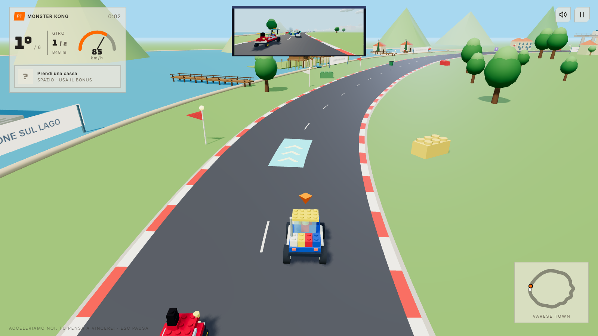
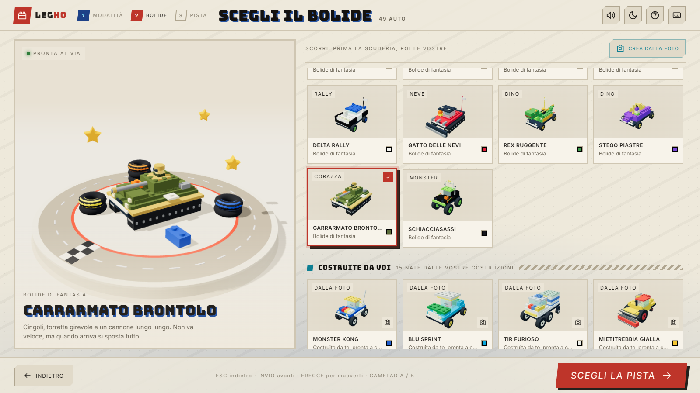

# Legho

Un videogioco 3D di corse a mattoncini per bambini di 6–10 anni. Tutto in italiano, accelerazione automatica, gare da poco più di un minuto. Gira interamente nel browser: nessun backend, nessun account, nessuna chiave API.

**Gioca online:** <https://martinocrippa.github.io/LeghoSeriousRaceGameWeb/>



## Come si gioca in locale

Serve **Node.js 22.12 o più recente** (va bene anche la 24 LTS) e un browser con WebGL — Chrome, Edge, Firefox o Safari recenti.

| Sistema | Come si avvia |
| --- | --- |
| Windows | Doppio clic su **`Avvia-Gioco.cmd`** |
| macOS | Doppio clic su **`Avvia-Gioco.command`** (la prima volta: tasto destro → *Apri* → *Apri*) |
| Qualunque | `npm install` e poi `npm run dev` |

Poi apri l’indirizzo stampato dal terminale, di norma <http://127.0.0.1:5173>. La finestra del server va lasciata aperta mentre si gioca; si chiude per spegnere il gioco. Aprire `index.html` con doppio clic **non** funziona.

Internet serve solo per l’installazione: da lì in poi auto, font, musica e analisi delle foto lavorano in locale.

### Comandi

| Azione | Pilota 1 | Pilota 2 |
| --- | --- | --- |
| Sterza | Frecce ← → | A / D |
| Rallenta | Freccia ↓ | S |
| Usa il bonus | Spazio | Maiusc sinistro |
| Pausa | Esc | Esc |

L’accelerazione è automatica: i bambini scelgono la traiettoria. Nei menu bastano frecce, Invio ed Esc; funzionano anche il touch e fino a due gamepad (levetta per sterzare, A bonus, B rallenta). I tasti si rimappano dal pulsante **Tastiera** in alto.

## Cosa c’è dentro



- **Diciannove circuiti** con scenografie a mattoncini ispirate a luoghi veri (elenco in fondo). Colline, ponti, gallerie, sopraelevate, giri della morte, scorciatoie, rotonde e ostacoli solidi sulla strada: banchi, birilli, bidoni e massi saltano per aria se li colpisce un razzo (e ricrescono dopo un po’), contro colonne e rotonde il colpo scoppia. Su Parco Increa, sulle Crete, a Regnano e a Villasanta gli animali attraversano la strada (tartarughe, pecore, cinghiali, l’asino e gli scoiattoli): chi ne investe uno se lo ritrova sul tetto per un secondo e mezzo.
- **Cinquantanove bolidi**: 34 di fantasia e **25 ricreati a mano dalle costruzioni dei bambini**, con la foto originale consultabile da un pulsantino sulla scheda. Ogni auto non nata da una foto riceve dal proprio nome qualche stranezza deterministica — una torretta storta, una bandierina da un lato solo, un cerchione spaiato: le costruzioni dei bambini non sono mai simmetriche.
- **Tre modalità**: gara singola, campionato su tre piste con classifica e podio, prova a tempo con record e nome del pilota. Uno o due piloti sullo stesso PC, schermo diviso.
- **Quattordici bonus** nelle casse: turbo, razzo, tre razzi, bomba con miccia, scudo, mitragliatrice di caramelle, gelatina (mezzo secondo incollati), macchia d’olio (si slitta, e a volte è testacoda), fontana di scintille, girandola, spara gelato, tre balle di fieno (schiacciano chi trovano: un secondo piatto come un biscotto), elica (sette secondi in cui dalle rampe si vola lontanissimo) e arcobaleno (sei secondi più veloce e intoccabile: chi tocchi esplode).
- **Musica scritta come dati**, non file audio: cinque brani chiptune, uno per atmosfera, più il punk della schermata iniziale.
- **Esplora la pista**: prima di scegliere, un elicottero sorvola il circuito in una decina di secondi. Dalla schermata iniziale ne incatena a caso, come la demo di un cabinato.
- **Crea dalla foto**: fotografi una costruzione, il browser la ritaglia dallo sfondo, misura proporzioni e colori, propone i pezzi e apre un editor con anteprima 3D. Fino a 12 auto personali salvate nel browser. Non è una ricostruzione fedele, ed è dichiarato: riesce quando l’oggetto sta su un tavolo di colore uniforme, altrimenti il gioco lo dice e lascia tutto alla personalizzazione manuale.

## Privacy

Non esce niente dal computer, nemmeno dalla versione online: nessuna statistica, nessun tracciamento. Le foto sono analizzate dal browser sui pixel in locale; garage, record, comandi e nomi stanno nel `localStorage` con il prefisso `brick-racers:` e si azzerano svuotando i dati del sito. `index.html` dichiara una Content-Security-Policy che vieta qualunque origine esterna, e il test `tests/browser/csp.spec.js` fallisce se qualcosa prova a caricare qualcosa da fuori.

## Se ci metti mano

```bash
git clone https://github.com/martinocrippa/LeghoSeriousRaceGameWeb.git
cd LeghoSeriousRaceGameWeb
npm install
npm run dev
```

| Comando | Cosa fa |
| --- | --- |
| `npm run dev` | Server di sviluppo su <http://127.0.0.1:5173> |
| `npm test` | Test della logica in Node: pista, gara, armi, auto, musica, ostacoli |
| `npm run test:browser` | End-to-end con Playwright su Chrome installato |
| `npm run test:browsers` | Prova di fumo su Chromium, Firefox e WebKit (il motore di Safari) |
| `npm run build` / `npm run preview` | Sito statico in `dist/` e anteprima |
| `npm run fixtures:cars -- --force` | Rigenera le impronte geometriche dopo aver rimodellato un’auto |

Note utili:

- I test browser avviano un server dedicato sulla porta 5179 (`BRICK_TEST_PORT` la cambia) e usano **Chrome installato**. Su una macchina senza Chrome: `BRICK_TEST_CHANNEL= npm run test:browser`, che usa il Chromium scaricato da Playwright. Per `npm run test:browsers`, la prima volta, serve `npx playwright install firefox webkit`.
- `npm run build` produce un sito statico servibile così com’è. Ogni push su `main` fa partire `.github/workflows/deploy.yml`: test, build e pubblicazione su GitHub Pages, solo se i test passano.
- **Musica**: come si scrivono i brani e le regole che i test fanno rispettare stanno in **[MUSICA.md](MUSICA.md)**.
- Il contratto delle scenografie sta in **[src/scenery/README.md](src/scenery/README.md)**.
- Prima di aggiungere una pista: `node scripts/eval-track.mjs '<definizione JSON>'` controlla raggi, incroci e distanze.

**Cosa i test non coprono.** Verificano che i modelli delle auto siano validi e renderizzabili, non che **somiglino** alla costruzione fotografata: quello si giudica a occhio. Il touch è emulato, i gamepad non sono provati con un dispositivo reale, e su WebKit è verificato che la scena disegni ma non come appare.

## Le piste

Tracciati inventati per la guida facilitata; le definizioni stanno in `src/tracks/`, le scenografie in `src/scenery/`. Le sagome non riproducono la viabilità reale e non usano mappe né immagini scaricate.

| Pista | Ambientazione | Gara |
| --- | --- | --- |
| Il circuito delle nuvole | Curve morbide e grandi salti | 3 giri · 550 m |
| Il Campo dell’Arca | Allenamento sotto la pioggia, tra le porte e il fango | 4 giri · 560 m |
| Regnano Castello | Il borgo di pietra tra i castagni, sotto le Apuane | 3 giri · 760 m |
| Golfo del Magra al Tramonto | La spiaggia, le cave di marmo e le rovine di Luni | 2 giri · 1100 m |
| Aprica: Corso Roma | L’otto tra Percorso Vita e Campo Vecchio, con le piste da sci | 3 giri · 700 m |
| Notte Stellata in Brianza | Montevecchia, Usmate e Arcore sotto le stelle | 3 giri · 660 m |
| Brugherio in Festa | La pista più veloce: asfalto e sanpietrini | 3 giri · 740 m |
| Milano Sprint | Duomo, tram gialli e Castello Sforzesco | 2 giri · 640 m |
| Il Giro del Lago di Como | Ponti di ferro, battelli e Bellagio | 2 giri · 980 m |
| Parco Increa Rally | Terra, alba e vento intorno al lago della cava | 3 giri · 720 m |
| Villasanta Centro | Dai sanpietrini alla Parabolica | 3 giri · 1100 m |
| Crete Senesi al Tramonto | Rally su e giù per le strade bianche | 2 giri · 840 m |
| Bergamo di Notte | Città Alta, Porta Nuova e lo stadio sotto le stelle | 3 giri · 680 m |
| Stadio degli Azzurri d’Italia | Dentro lo stadio, con il giro della morte | 2 giri · 740 m |
| L’Adda d’Autunno | Il traghetto di Leonardo e il Ponte San Michele | 3 giri · 800 m |
| Passo del Bernina | Il trenino rosso, Tirano e i tornanti del passo | 2 giri · 900 m |
| La Scuola all’Alba | Dentro la scuola prima della campanella | 3 giri · 980 m |
| L’Aula all’Intervallo | Tra i banchi, le matite e le merende | 3 giri · 760 m |
| Varese Town | Dall’autostrada alla collina, e giù al lago | 2 giri · 1180 m |

Con **Coppa · 3 piste** la pista scelta apre la serie e le due successive seguono in ordine: da Brugherio arrivano Milano e Como, da Como arrivano Parco Increa e Villasanta.

---

## Licenza

Codice sotto licenza MIT ([LICENSE](LICENSE)). Le foto in `sample/` e gli screenshot in `docs/` restano di tutti i diritti riservati. Componenti di terze parti in [THIRD_PARTY.md](THIRD_PARTY.md).

Scritto con Claude Code a partire dal 15 settembre 2026. Si parla di “mattoncini”: Legho non è affiliato a nessun produttore di giocattoli.
